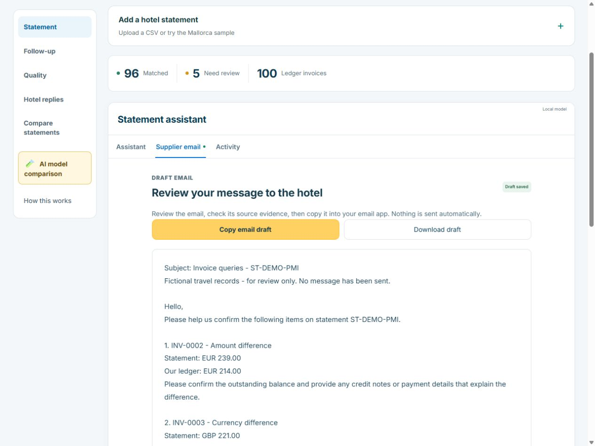
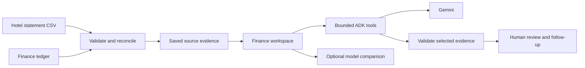
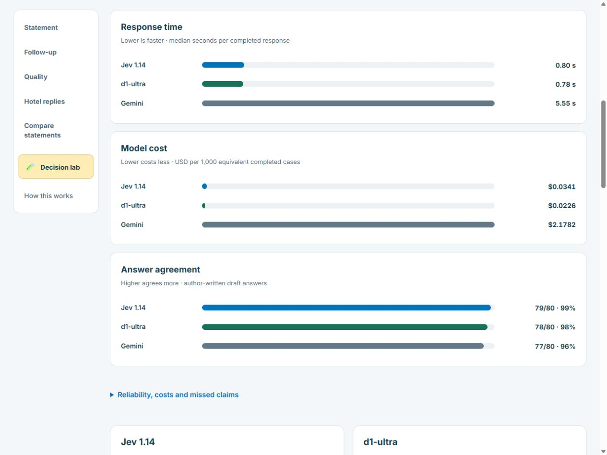

# Holiday Supplier Workspace

**Hotel supplier reconciliation, evidence-backed explanations and human-reviewed follow-up.**

A finance workspace built with **Google ADK, Gemini, FastAPI and Google Cloud**. Upload a hotel statement, inspect invoice differences and prepare a supplier email with the supporting evidence in view.

> Independent portfolio project created around a travel-finance use case. All hotel, booking and finance records are fictional. The loveholidays branding provides visual context; this project has no company affiliation or endorsement.



*The local workspace turns invoice findings into a readable email draft. A person checks the evidence and decides what to send.*

## The business problem

A hotel says an invoice has **EUR 239.00** outstanding. The finance ledger says **EUR 214.00**. Someone must check the invoice, credits and payments before agreeing a balance.

The workspace places both records beside their source rows. A finance operator can ask what needs checking, inspect the cited evidence, review a supplier email and record that they are waiting for the hotel to confirm a credit note. The difference identifies work to investigate; it does not establish which source is correct.

## Try the full workspace locally

Requires **Python 3.13**, [uv](https://docs.astral.sh/uv/getting-started/installation/) and a browser. No model key is needed for this offline walkthrough.

```sh
uv sync --locked
uv run uvicorn decision_preview:create_app --factory --app-dir tests --host 127.0.0.1 --port 8774
```

Open **http://localhost:8774/**. The fixture's public test password is:

```text
A fictional password for tests only!
```

Choose **Help → Restart guided tour** to work through one invoice. This local fixture uses an in-memory store, deterministic model stand-ins and recorded comparison results. It drives the real HTTP and ADK workflow without paid model calls. Its records reset when the process stops. Keep it bound to localhost and use a separate private password for a deployed service.

For a command-line report:

```sh
uv run python -m reconciliation demo --supplier SUP-PMI
```

Open the report path printed by the command. Other fictional suppliers are `SUP-AGP` for the Costa del Sol and `SUP-AYT` for Antalya. [Setup and live-model options →](docs/SETUP.md)

## What the workspace does

| Task | What a finance operator sees |
| --- | --- |
| Import a statement | CSV validation and a preview before saving |
| Reconcile invoices | Amount, currency, duplicate and missing-record findings |
| Ask a question | An ADK-backed answer linked to the saved invoice evidence |
| Review a supplier email | A readable draft, original source detail, copy/download and human confirmation |
| Check a hotel reply | Quoted claims, linked invoices and a proposal that requires human confirmation |
| Track the next step | Waiting, resolved and reopened cases with saved history |
| Compare statements | Before/after snapshots that preserve original currencies |
| Compare models | Jev, d1-ultra, Gemini and rules on the same fictional messages |

The application sends no email, changes no financial balance and authorises no payment. The operator uses their normal email process after reviewing the draft.

## Why Google ADK is here

Python code validates the source records and reconciles money. ADK gives the model a small, supplier-scoped toolbox for investigating findings. The server validates the model's evidence selections and renders the financial wording from saved records.



The hosted version uses **Cloud Run** for the application, **Cloud Storage** for source bundles and saved records, and **Secret Manager** for runtime credentials. Model keys stay on the server. The simulated finance API keeps the project independent of a company's accounting systems.

[Architecture and module map →](docs/ARCHITECTURE.md)

## Model comparison



Jev, d1-ultra and Gemini receive the same text tasks. The comparison shows response time, cost, agreement with draft reference answers, missed claims and failed attempts. Users can change the advisory handover threshold on saved results without making another request.

These are **small fictional experiments with author-written draft labels**. They illustrate an evaluation workflow; they do not establish production accuracy, a universal model winner or business savings. Recorded replay makes no model call. Fresh comparisons use the configured providers and can incur charges.

[Evaluation method and limits →](docs/EVALUATION.md)

## Code and checks

The Python service and browser code live together, with a thin JavaScript interface and no frontend framework. Python and browser-state tests cover reconciliation, access boundaries, source integrity, repeated requests, human confirmation, tool budgets and guided-tour transitions.

```sh
uv run pytest -q
uv run ruff check .
uv run ruff format --check .
uv run python -m reconciliation check-evals
npm ci
npm test
npm run format:check
```

Node.js 22 or later runs the browser-state tests and formatting tools. The automated tests use offline models. Model-based ADK evaluations are a separate opt-in operation.

```text
reconciliation/   Service, ADK runners, validation, storage and browser assets
reconciler/       ADK development entry point
data/             Fictional hotel statements and payable ledger
evals/            Evaluation cases and scoring configuration
tests/            Python integration tests and browser-state tests
tools/            Optional bounded comparison experiment runner
docs/             Setup, architecture, evaluation and screenshots
```

## Deployment and limits

The [Dockerfile](Dockerfile) starts the hosted workspace as an unprivileged user and excludes evaluation-only dependencies. Known evaluation-tool advisories and their deployment limits are documented in [SECURITY.md](SECURITY.md). [SETUP.md](docs/SETUP.md) lists the runtime configuration and deployment requirements. The repository includes no cloud account IDs, deployed password, API keys or private run records.

The matcher expects complete open-item CSV snapshots. It preserves GBP, EUR and USD amounts and performs no foreign-exchange conversion or PDF ingestion. The current hosted portfolio uses a shared password and expiring sessions. A company rollout would need individual identities, organisational access policies, retention rules and approved finance connections.

[Security boundaries and operational limits →](SECURITY.md)

## Branding and code reuse

The owner has not assigned an open-source license to this code. The repository is public for portfolio review. Third-party dependencies retain their respective licenses. The loveholidays name and logo belong to their respective owner; see [THIRD_PARTY_NOTICES.md](THIRD_PARTY_NOTICES.md) for the source and scope of the branding.
